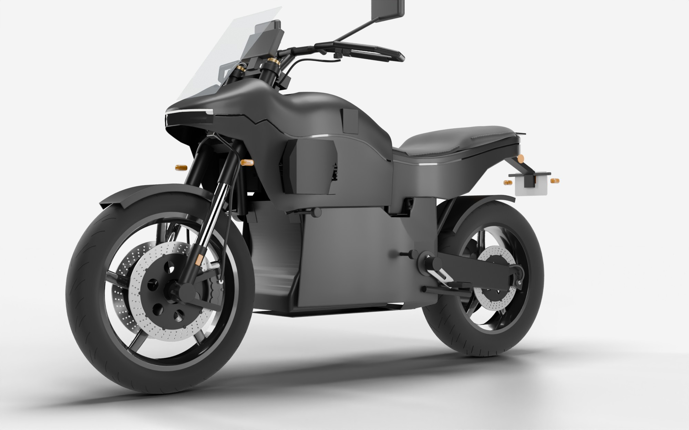
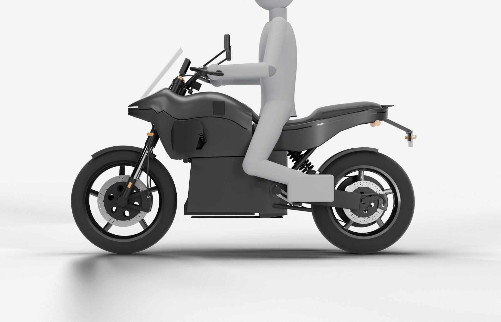
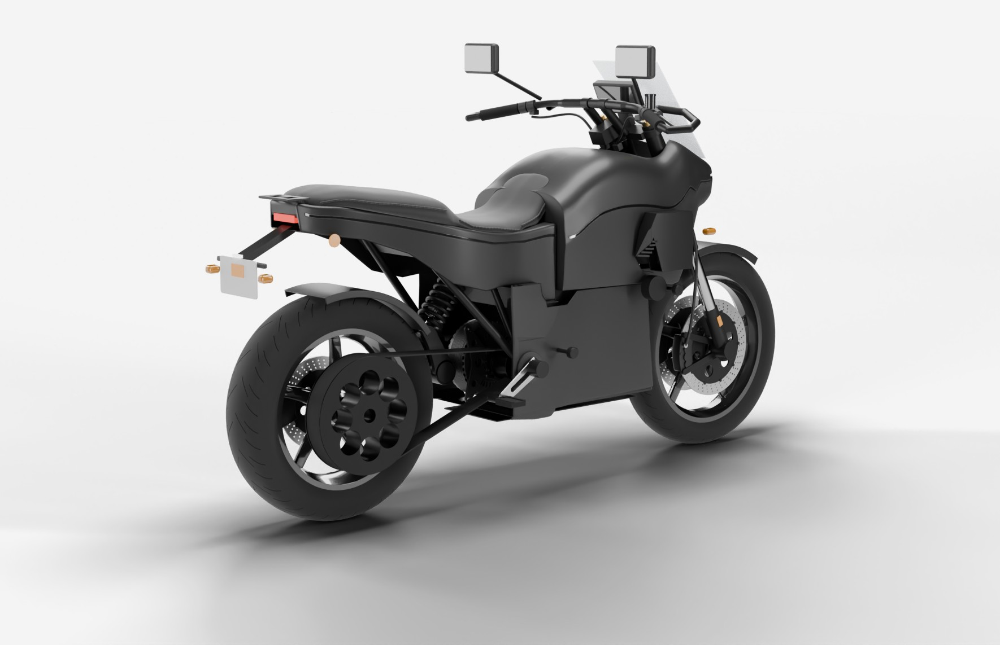
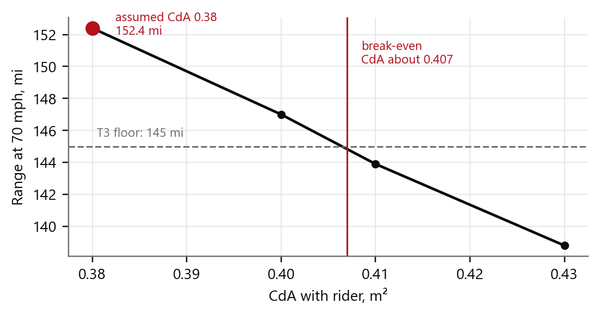

<h1 align="center">Bavuso Motors V1</h1>

<strong>Electric adventure touring · concept freeze</strong>

  <a href="v1.0/final/Bavuso-V1-Summary.pdf">2-page summary</a> ·
  <a href="v1.0/cad/Bavuso-V1.0-adventure.FCStd">FreeCAD model</a> ·
  <a href="v1.0/final/Bavuso-V1-Design-Dossier.pdf">Design dossier</a>

  

A solo electric adventure-touring motorcycle designed in CAD and evaluated through simulation. V1 integrates the battery, belt drive, chassis, cooling and rider package into one design. The motorcycle has yet to be built or road-tested.

| Pack energy | Estimated wet mass | Modeled highway range | Modeled DC charge |
| :---: | :---: | :---: | :---: |
| **23.76 kWh** gross | **257.9 kg** without rider | **131.8 mi** at 70 mph | **~21 min** from 10–80% at 25 °C |

## What the design looks like

<table>
  <tr>
    <td width="50%"></td>
    <td width="50%"></td>
  </tr>
  <tr>
    <td><strong>Rider fit.</strong> Seat, pegs and controls in the modeled riding position.</td>
    <td><strong>Rear packaging.</strong> Swingarm, rear wheel and luggage area.</td>
  </tr>
</table>

## The result that changed the design

V1's range target was **145 miles at 70 mph**. The drivetrain model yielded **152.4 miles** with the original drag-area assumption of 0.38 m². Substituting the finest OpenFOAM mesh result, **0.46 m²**, reduced the estimate to **131.8 miles**, a **13.2-mile shortfall**. The run assumes flat road, still air, a 90 kg rider and a 25 °C pack. Mesh convergence remains open, and the range result makes drag reduction the first priority for V1.1.

## Inspect the engineering

| Work | Start here |
| --- | --- |
| **CAD and packaging** | [Editable FreeCAD assembly](v1.0/cad/Bavuso-V1.0-adventure.FCStd) · [CAD revision E and clearance checks](v1.0/program/16-cad-revE.md) · [Frame drawing](v1.0/drawings/BV-ASM-0201_frame-welded-assembly.pdf) |
| **Aero and range** | [CFD study and mesh limits](v1.0/program/17-aero.md) · [Range model source](v1.0/program/tools/aero-v1-range.py) · [Saved range results](v1.0/program/data/aero/range-70mph.json) |
| **Structure and cost** | [Structural analysis and FEA iterations](v1.0/program/09-structures.md) · [Cost model and volume sensitivity](v1.0/program/11-cost.md) |
| **V1 decisions and open validation** | [Final spec and target verdicts](v1.0/program/00-V1-final-spec.md) · [Design dossier](v1.0/final/Bavuso-V1-Design-Dossier.pdf) |

The [B0 development package](documentation/README.md) records the earlier feasibility work and architecture alternatives that led to V1.
