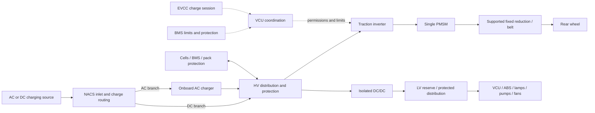

# Architecture and interface control

B0 · October 25, 2026. This is the interface definition framework. It contains no approved pinout, safety integrity rating or construction wiring diagram.

## System boundaries

Each physical item gets exactly one leaf BOM owner. Assemblies reference leaves rather than adding a second mass. Cell-group internal restraints belong to pack; frame brackets outside the pack belong to chassis; cold plates belong to pack but coolant inventory belongs to thermal. Brake hydraulic fluid belongs to brakes; all coolant belongs to thermal. Vehicle cables belong to vehicle harness, internal pack interconnects to pack. Supplier-installed hardware stays inside its supplied assembly unless removed from its mass record.

Arrows indicate function, not a released busbar layout. The actual AC/DC shared-contact routing, pole switching, isolation boundary, protective earth implementation, fault-current protection and interlocks require the selected inlet/charger/EVCC architecture. No converter is implied between station DC and battery unless a later study explicitly adds one.

## Interface deliverable contract

The [interface register](registers/interfaces.csv) identifies both owners and required closure evidence. Every electrical interface requires connector manufacturer/part/options, mating connector, terminal/seal/cavity plugs, cavity-to-signal assignment, wire size/type/color, shield termination, allowable voltage/current/temperature, keying, lock, routing, strain relief and test method. Cable maximum length and bending radius come from actual parts and installation. An unselected connector cannot be represented as a finalized harness.

Every fluid interface requires fluid specification, compatibility, flow/head and pressure/temperature envelope, fitting and seal part numbers, port orientation, hose construction and ID, clamp/crimp spec, movement allowance, bleed/fill/drain procedure and leak-test limits. Different coolant circuits need unmistakable fill/service identification.

Every mechanical interface requires datum scheme, tolerance stack, mounting loads and directions, fatigue spectrum, material and finish pairing, fastener joint calculation, torque/lubricant/locking conditions, tool access, service removal and inspection criteria. Mounting bolt diameter cannot be selected just because a render shows a bolt.

## Drawing datum proposal

Use vehicle coordinate X forward, Y left, Z up. Origin is the rear contact-patch center at nominal laden ride height. Wheelbase is the distance between contact centers; the study is 1420 mm. Specify loaded rolling radii, suspension sag, payload and tire pressure when a datum is measured. Rear axle is at X0, approximately Z312 mm in the geometric tire study; the front at X1420, approximately Z300 mm. These are packaging references, not tooling datums.

For manufacturing, assign stable physical datums on each actual component: steering-bearing bore axis, swingarm pivot axis and frame center plane for chassis; mounting pads and module locating features for pack; supplier-defined register faces for motor; actual bearing seats for wheels. The chassis drawing must explain how functional geometry is inspected from its datum reference frame. Avoid dimensioning the vehicle entirely from removable panels or a deformable tire.

Tolerance studies must cover steering-head/pivot alignment, axle and belt pulley alignment throughout travel, wheel spacers/bearing preload, caliper alignment, motor shaft/adapter concentricity, enclosure sealing/compression, panel gaps, harness movement, cell growth and assembly/service clearance. Numerical tolerances remain unset until load, process and supplier fits are known.

## Software/configuration boundary

Separate VCU supervisory logic, inverter firmware/calibration, BMS configuration, EVCC firmware/credentials and ABS firmware/calibration. Maintain an approved compatibility matrix with checksums, hardware revisions and rollback policy. A working CAN bus does not establish correct torque arbitration.

Every commanded torque must be bounded by validated rider demand, BMS charge/discharge limits, inverter/motor thermal/current/speed limits and chassis traction/ABS coordination. Regen must reduce when pack is full, cold, hot, faulted or charge limited; the rider still needs predictable friction braking. Correct loss-of-communications behavior must be established for each pair, with timeout values determined from the safety analysis and actual message timing.

Diagnostics shall record first fault, operating state, relevant voltages/current/temperatures, software versions and timestamps; distinguish warning, derating, torque inhibit and controlled isolation. A critical event cannot depend exclusively on a phone connection. Mechanical emergency controls and workshop isolation must remain usable without cloud access.

## Receiving a supplier configuration

Do not purchase a family name alone. Store the exact manufacturer ordering code, options, drawing revision, firmware and mating parts. Record voltage/winding/cooling/resolver options for motor; switch variant, cooling and firmware for inverter; output range/input range/isolation/CAN for charger; electrode/terminal/dimensional revision for cell. Supplier deviations require an engineering change record.

Mass, dimensional envelope and ratings are tied to those exact configurations. Availability, MOQ, price and lead time remain unknown until dated quotations. No costs are invented in this package. The research files are a source trail; licensing and source-document redistribution rights need review before a public repository.
