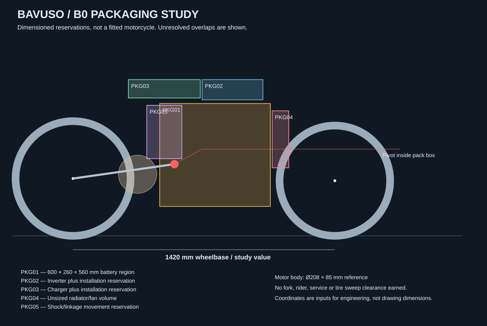

# Packaging, styling and aero development

B0 · October 25, 2026. A measured package is the next physical design output. This study exposes space claims and conflicts; it does not claim a finished layout.

The master images are an appearance specification: preserve recognizable surfaces, screen, upright controls and restrained branding where engineering permits. They are perspective images with generative inconsistencies. Never derive wheel offset, brake hardware, belt tooth count, material thickness or a mounting axis by scaling pixels.

## Coordinate study

Editable inputs: [JSON](models/package-reservations.json). Editable 3D reservation solids: [OpenSCAD](models/package-reservations.scad). Rebuild from [the Python script](tools/build-development-model.py). OpenSCAD is a portable study file; it has not been executed or exported to STEP in this workspace. Solids are installation reservations, not manufactured parts. The SVG is generated directly from the same coordinates, so its dimensions can be audited.

X forward, Y left, Z up; rear contact origin, mm. Working wheelbase 1420; rear geometric rolling radius 311.9 and front 299.9 from tire-size arithmetic. Loaded measured radii will differ. Battery reservation occupies X470–1070, Y±130, Z160–720. These are proposed input coordinates, not inherited dimensions from the owner render.

The motor body is a Ø208 × 85 mm cylinder with trial axis X350/Z335. Its 42.5 mm half-width excludes terminals, resolver, coolant connections, rotor clearance, mounting plate and supported drive shaft. The 16 mm side-projection gap between its body and the rectangular pack box earns no installation-clearance credit.

Inverter and charger boxes deliberately add installation room beyond bare bodies; no current connector-bend or harness drawing validates it. Heat exchanger size is an unsized reservation. Seat/grip/peg reference points are construction aids for a future buck, not anthropometrically proven hardpoints.

## Conflicts revealed rather than hidden

The [automated conflict register](registers/packaging-conflicts.csv) currently identifies:

1. The trial swingarm pivot X550/Z390 lies inside the rectangular battery reservation. A rectangular 600 mm pack cannot simply occupy that whole region with this pivot. Change the pack rear shape, move its reservation, change the pivot geometry or distribute modules. All options alter volume, structural paths and service access.
2. Rear shock/linkage reservation overlaps the battery reservation over 120 × 180 × 290 mm. This is a conservative rectangular reservation overlap, not a detailed part collision. A different linkage, shock position or sculpted pack may resolve it, but the full motion and removal paths must be demonstrated.
3. The motor and rear-tire circular envelopes overlap: their center separation is approximately 350.76 mm versus 415.9 mm summed radii. Their transverse spans overlap too. The motor position therefore needs revision even before suspension movement is considered.
4. The front radiator box intersects the nominal front-tire envelope. Its closest point to the front axle in side projection is approximately 259.64 mm away, inside the tire's 299.9 mm geometric radius, with overlapping transverse spans. This is an existing static reservation conflict as well as a warning about future steer/bump sweep.
5. The motor envelope intersects the shock/linkage reservation. The nearest box point is approximately 98.62 mm from its axis, inside the motor's 104 mm radius, with overlapping transverse spans.

Moving the pack forward consumes front-wheel/fork/brake-hose swept room. Moving it up affects seat height, width and CG; moving it sideways affects rider fit and lean clearance. Moving the motor/pivot to create room changes belt tension through travel, anti-squat, swingarm length and shaft support. Eliminating a visible clash is not enough; rerun all dependent interfaces.

The cylinder checks use full circular tire and motor envelopes and boxes, not detailed toroidal tires or manufacturer installation geometry. These five conflicts identify incompatible reservations; they are not a qualified solid-part interference report. This model does not include frame members, fork motion, full tire growth, steering sweep, foot controls, rider, luggage or service tools. Five detected conflicts are not a claim that all other clearances pass. The next engineering CAD iteration must replace each reservation with supplied geometry and actual motion.

## Pack shape avenues to evaluate

| Arrangement | Opportunity | Required evidence before selecting |
|---|---|---|
| One narrow rectangular assembly | Lowest geometric complexity and simple common enclosure | Must clear pivot/shock; current reservation does not |
| Rear relieved / stepped enclosure | Preserve one pack while clearing pivot/linkage | Discrete module packing, local stiffness, coolant/vent routes and achievable energy |
| Upper/lower internal groups in one case | Use body volume without widening knee region | Cell orientation/tab joining, pressure plates, hot-spot control, assembly/removal and impact protection |
| Two chassis-supported service enclosures | Fit distributed volume | Added shells, interconnects, isolation/service complexity and verified mass penalty |
| Smaller 100s7p pack | Removes 100 cells, approximately 9.73 kg typical cell mass | Comfortable low-drag result and revised charge/thermal/current qualification |

Do not use the old ten geometric stacks as a module design. An electrical 10s8p grouping must be reconciled with tabs, busbars, compression, cooling and isolation. Deleting volume from a box without a discrete cell layout does not prove the same energy fits.

## Body and rider interface deliverables

Define a reference rider, measured suit/helmet, sitting posture, grip loading and seat setting for aerodynamic tests. Use a buck with adjustable seat height/width/slope, peg location and bar rise/reach/sweep. Record dimensions and subject measurements rather than generic height labels. Check low-speed maneuvering, emergency braking posture, standing on pegs if intended, ground reach, mirror view, instrument reading, glove operation and helmet screen sightline. The population and acceptance thresholds need approval before a fit claim.

Screen shape must be investigated with its mounting stiffness. Test wake at helmet, shoulders and torso, including sidewind and following a larger vehicle under controlled conditions. A low-drag result with painful buffeting fails the product. Do not credit a race tuck toward ordinary highway range.

For each panel define structural versus cosmetic role, material/process, thickness derived from loading/manufacture, UV/fire/chemical requirements, edge radii, inserts, gasket/drain paths and service fasteners. Draw part split lines and removal order before final styling. Battery case opening and routine body panel removal are different service operations. Panel screws must not double as unreviewed pack-retention joints.

Seat definition includes foam construction and support pressure, pan stiffness, attachment/latch secondary retention, weather barrier, stitching/seam leakage, contact heat, abrasion, cleaning and replacement. Color specification includes physical master samples, lighting conditions, permissible color/gloss variation and repair strategy. Current generated matte finish is not a production coating recipe.

## Aero experiment plan that can determine the battery

Hold the same reference bike/rider and record all changes. Start with two screen heights, two screen-rake/curvature treatments and two lower-front/side air-management concepts: an eight-case screening design. Values must come from the buck and feasible body geometry, not arbitrary millimeters. Include real cooling pressure loss, mirrors, wheel rotation/ground treatment and rider clothing in later correlated cases. Resolve the main flow trend before adding fine surface details.

Measure or calculate drag, front/rear lift, side force, yaw/roll/steering moments, cooling mass flow and helmet wake fluctuation. Start with yaw 0, ±5, ±10 and ±15 degrees at 77 mph; 20 mph direct crosswind corresponds to about 14.6° apparent yaw at that ground speed. Those cases define analysis coverage, not an approved safe wind limit. A multibody dynamics model needs measured mass/inertia, tire properties, rider coupling and steering characteristics before static forces can imply handling.

The energy-led 30.056 kWh reference targets total comfortable-rider CdA ≤0.33 m². The 26.299 kWh path should investigate ≤0.30 for useful new-battery margin. These are demanding targets: published full-scale research found materially larger upright-rider drag on its tested conventional motorcycles. That work is evidence to challenge our assumption, not proof this shape cannot improve it. [Kirca and McGordon, primary paper](https://wrap.warwick.ac.uk/id/eprint/180779/1/WRAP-Effect-rider-position-energy-consumption-23.pdf)

Use CFD for ranked design development with documented geometry, mesh, domain, turbulence/transition approach, wall treatment, rotating wheels, cooling representation, convergence and force balance. Correlate with wind tunnel or appropriately designed coastdown/road-load tests; no CFD has yet been run here. Rough hand-drawn arrows on the render are not flow simulation.

## Required next package outputs

Release an assembly tree of real CAD parts, longitudinal/plan/transverse sections, suspension and steering sweeps, tire growth/load cases, pack insertion/removal sweep, harness/fluid routes, brake/drive service sequences, rider variants, loaded ground/lean clearances and dimensioned datum drawings. Export neutral geometry with units and revision; retain native parametric sources. Record package mass properties separately from supplier and measured masses. No mesh of the styling render can substitute for those engineering surfaces and assemblies.
