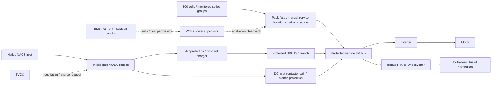

# Battery, electrical, charging, controls and thermal system

Revision A, October 25, 2026, US Central. Prepared by Codex. **Engineering development definition; not a released wiring or battery construction package.** Candidate parts and mathematical counts below are specific enough to assign supplier and integration work. Unspecified ordering suffixes, ratings, thresholds and dimensions are intentionally blocked from fabrication; inventing them would defeat reproducibility.

Read alongside the [source register](../research/electrical-sources.md) and [electrical component register](../registers/electrical-components.csv). Source identifiers ES01–ES14 resolve there. The three finish references are black, silver and tan in `design/`; color has no authority over electrical clearances or cooling openings.

## 1. Configuration and evidence boundary

Carry **100s8p SA504, 800 cells, 30.056 kWh typical nominal**, one frame-mounted motor/inverter, native NACS inlet, independent AC and DC charging paths and a 12 V-class auxiliary system as the development configuration. These choices remain conditional on qualified cells, measured package, motor maps and network onboarding. They are not a claim that all goals fit under 400 lb.

ES01 reference cell values: 37.57 Wh typical / 36.72 Wh minimum; 97.3±2 g; 3.4 V nominal, 4.2/2.5 V endpoints; 10.8/21.6 A typical/maximum charging; 66.3 A continuous discharge; charge 0–45°C. The catalog's 500-cycle result uses +1C/−1C to 80% SOH, not repeated maximum-rate charging. These are published reference boundaries, **not selected control setpoints**. Do not substitute 1 kHz AC impedance for DC heat resistance. [ES01]

Calculated pack reference: 340 V nominal; 250–420 V sum of cell endpoints; 88.4 Ah typical; 30.056 kWh typical / 29.376 kWh minimum-energy case; cells 77.84 kg typical. Neither the full endpoint range nor all nominal energy is promised usable. Pack current is shared across eight parallel cells only under ideal equal impedances. Group voltage sensing cannot identify the current or temperature of every individual parallel pouch.

The 97.30 kg pack allocation assumes 80% cell mass fraction, leaving 19.46 kg for every pack-internal function. The 800 cells at maximum published cell mass would add 1.60 kg before any pack hardware tolerance. A component register with blank masses is not evidence that the allocation is met.

### Correct the motor revision before packaging

EMRAX208 MV LC v1.7 now lists **47 kW / 75 Nm continuous and 86 kW peak for 30 seconds**, not the old v1.5 values. LC mass remains 10.3 kg. Supplier states all variants need airflow, approximately 0.4 m³/min per kW, and must not be fully enclosed; minimum coolant 6 L/min, maximum inlet 50°C. Current models are being phased out for the next family. [ES02]

At the previous road-load reference, 125 mph requires about 41.0 kW shaft and 73.8 Nm at approximately 5,304 rpm. Thus the new 75 Nm continuous reference provides little torque margin, and neither a 47 kW headline nor this comparison proves availability at low SOC or installed temperatures. Keep 45 kW continuous / 60 kW short-duration shaft output as a requested design target, **not a qualified rating**. The supplier must approve the exact installation or a replacement must be evaluated. A larger successor diameter cannot be absorbed after frame freeze without a package change.

## 2. Power architecture and switching ownership

This is a **functional topology**. It does not authorize wiring. In the proposed shared-bus arrangement the main pack contactors energize the bus during charging to power necessary auxiliaries. Inverter gate/torque authorization remains independently inhibited throughout any plug-connected state. Charging input is isolated by dedicated inlet contactors and routing; DC from the pack must never appear at an exposed or AC-connected inlet.

Native NACS uses a common power-contact pair for AC and DC. It therefore needs a selected supplier solution that positively prevents an AC/DC cross-connection; an EVCC alone does not route power. Keep the routing module's internal switches **unselected** until its failure analysis and installation drawing are supplied. Counting only two charge contactors as the complete routing hardware is incorrect. A supplier-integrated routing solution may consolidate parts, but the register must then identify which functions it contains.

Proposed discrete baseline: two normally-open pack main contactors; one precharge switching device plus resistor branch for the traction bus; two normally-open DC inlet contactors; separate mutually exclusive AC/DC routing assembly; protected OBC output branch. Confirm whether the selected OBC requires an additional output contactor to prevent backfeed. If the supplier routing assembly includes the DC pair, replace those discrete rows rather than double-counting them. Mechanical auxiliary contacts and bus/inlet voltage measurements together support weld diagnostics; a commanded state is not proof of an open contact.

The VCU owns vehicle state and requests main switching. The BMS owns cell-based permission and CCL/DCL; a hardware inhibit can withdraw permission independent of normal CAN messaging. The EVCC owns station communication and charge sequence requests, including a hardware emergency charge disconnect path appropriate to its certified interface. One supervised arbitration layer resolves these requests; do not let three controllers drive the same coil independently. Loss of any required permission blocks closure. Coil-driver outputs need feedback and failure analysis for short-to-battery and short-to-ground.

Protective earth from the inlet is routed and bonded as the selected charging architecture requires. HV conductors remain insulated from the chassis; do not use the frame as a traction-current return. Record the chassis bonding strategy, resistance requirements and isolation test method on released drawings. Coordinate vehicle isolation monitoring with the EVSE's measurement sequence to prevent interference. [ES04, ES06, ES14]

## 3. Pack subdivision and monitoring requirements

Use the notation **G001…G100** for 100 series groups, each containing eight cells **C01…C08**. This names electrical objects without prescribing tab welds or physical position. A provisional ten-subassembly study could contain ten 10s8p electrical subassemblies. Each is 80 cells, 34 V nominal, 42 V full endpoint and 3.0056 kWh typical. This is **not equivalent to the earlier 4×2×10 geometric stack exercise**: cell orientation, tab reach, series jumpers and removal path must be designed together before those two views can be reconciled.

The component register carries ten proposed mechanical subassembly sets and 100 monitored voltage groups. It does not carry a fictitious count of 100 ready-to-buy modules. No internal busbar gauge, weld pattern, compression load or individual-cell fusible link is released.

Before a module drawing is released obtain from Amprius: application acceptance; current controlled cell drawing and tab alloy/coating; permitted joining process and heat exposure; minimum/maximum face pressure over life and temperature; swelling map; allowable support/edge loads; voltage/current/temperature operating maps; DC resistance and short-circuit evidence; traceability/lot acceptance and transport data. A 30 PSI requirement on another Amprius cell is **not transferable** to SA504.

Require every group voltage, pack current, independently measured bus voltage, temperature channels selected by thermal coverage, coolant inlet/outlet temperatures, leak/isolation status and service-interlock state. Temperature sensor quantity is an analysis output, not an arbitrary one-per-module guarantee. Prove detection of the hottest pouch under the worst credible fault and cooling failure. Each parallel cell needs a defined inspection/traceability identity even if it lacks individual electronic monitoring.

Orion BMS2 108-channel version is the development reference for 100 groups. Obtain the correct manual for eight unused inputs and channel-bank restrictions, sense-wire protection/routing, balancing heat and thermistor expansion. Do not infer a 108-channel product can be wired in any arbitrary order. A later distributed BMS may save harness mass but restarts electronics, diagnostics and qualification work. [ES07]

Internal-short and propagation management remains a separate design problem: eight parallel pouches can feed a failed cell even after the main pack contactors open. Determine whether fusible cell links can isolate a fault without nuisance operation, using measured fault energy and qualified joining. Neither the main fuse nor a temperature sensor automatically prevents propagation. Enclosure venting, barriers and fault gas management need abuse evidence and rider-directed hazard analysis.

## 4. Electrical sizing and protection coordination

Development load envelope: 70 kW DC peak equals 206 A at 340 V or 280 A at 250 V. The actual lower operating voltage may be higher; select it from sag, life and drive maps. The ideal cell split at 280 A is 35 A per pouch, not a fault-current bound. Motor phase currents must be sized from inverter/motor operating maps, independently of DC current.

TE HVP800 provides a documented connector study with 250 A continuous at 85°C on 50 mm² wire; its family includes HVIL and shielding. This is not automatic approval for 280 A duty or the motor phase circuit. Select variant, conductor size, ambient derating, terminal/crimp tool and bend radius from the full installation data. Consider a higher-current family if the actual temperature/duty does not fit. A larger connector can add cable stiffness and mass; do not select from current alone. [ES10]

GX14 is a 350+ A, 12–800 VDC contactor family reference; exact coil, auxiliary contact, polarity and installation variants remain open. The carrying rating does not demonstrate interruption of the pack's available fault current. [ES11–ES12]

Protection study must deliver all of the following before a fuse ampere rating is selected:

1. Measured/validated worst prospective fault current versus SOC, temperature and age, including eight parallel cells, interconnects and cable inductance/resistance. Model locations at pack output, inverter input, inlet branch, OBC and DC/DC.
2. Normal current-time envelope: drive, acceleration, grade, regen, precharge, charger inrush and accessory starts, with ambient/bundle derating. Trace fuse thermal memory across repeated events.
3. Fuse DC voltage and interrupt capacity above the worst circuit demands, with time-current and total-clearing I²t coordinated to cable insulation, terminals, busbars, cells, enclosure and semiconductor exposure. A fuse may protect a conductor without saving an inverter transistor.
4. A policy for faults below a high-speed fuse's minimum breaking current. Contactor interruption capability and controlled shutdown must cover the residual region. Do not copy the 125 A 25EV1K example from ES13 into a 280 A traction circuit.
5. Separate branch protection for OBC output/input where required, DC/DC, precharge, heater if adopted and LV loads. Main pack protection cannot be assumed to protect a thin branch wire.

Precharge requires actual inverter/OBC/DC/DC connected capacitance and leakage. Initial resistor current is V/R; capacitor stored energy is ½CV²; ideal voltage rise is V(1−exp(−t/RC)). Resistor pulse energy, repeated restart duty, contactor DC make/break, precharge timeout and voltage feedback tolerances must be derived. **No precharge resistance or delay is selected from an assumed capacitor value.** Require detection of failed-open, failed-short and welded paths. Residual-energy discharge and voltage verification need a specified circuit and time criterion from the applicable requirements.

## 5. LV power, controls and harness

A protected LV battery supplies boot, BMS/VCU/EVCC, isolation monitoring, contactor actuation and necessary emergency functions before the traction pack closes. An isolated converter replenishes it while drive or charge is active. A pack-only converter without stored LV energy risks a boot deadlock. A depleted LV battery needs an accessible, polarity-protected recovery procedure; phone/app access cannot be the only way to open charging access.

Choose LV capacity from measured startup current, contactor pull-in, ABS pump transient, lighting, fan/pump operation, standby duration and continued critical loads after a traction isolation event. Converter output is not selected from the former 300 W average auxiliary assumption: 300 W is an energy-model input and cannot cover all peak loads by assertion. Preserve ABS, brake lamps and essential indication during a controlled torque shutdown to the extent required by the hazard analysis. Do not turn off the entire LV bus as a generic response to a recoverable traction fault.

The VCU hardware is unselected. Required resources include independently monitored torque inputs, watchdog, protected I/O, separate communications domains where justified, nonvolatile diagnostic log, controlled firmware/configuration identity and a defined recovery path. Dual-track throttle plausibility, brake/torque arbitration, side-stand/start/run interlock, wheel-speed/ABS interface and motor speed/temperature feedback need a safety analysis. A consumer touchscreen must not be the sole torque or essential-indication controller.

Harness deliverables must enumerate **every cavity**, mate, seal, blanking plug, terminal, splice, shield termination, wire family/gauge/color/length, label, clamp and service loop, with drawing revision and crimp tooling. Assign connector identifiers only after endpoints are frozen. Present register quantities for harnesses are assembly counts, not a substitute for a cut list. Separate noisy phase cables and sensitive sensing/CP/PLC paths; qualify EMC with charger and inverter active. Demonstrate full steering/suspension motion, heat/chafe clearance, wash exposure, cable strain relief and accessibility while wearing gloves.

### Proposed logical signal contract

The table is a **Bavuso functional contract**, not a DBC or actual pinout. Periods are development proposals to be reconciled with supplier protocols and fault-tolerant timing. Units, sign, scaling, endian order, invalid encoding, counter/CRC, bus allocation and IDs must be fixed in a released DBC and interface-control drawing; do not improvise frame IDs.

| Sender → receiver | Signal group | Proposed update | Required behavior on invalid/stale data |
|---|---|---:|---|
| BMS → VCU/inverter supervisor | CCL A, DCL A, pack V/A, validity, stop permission | 20 ms | No new torque increase; validated controlled torque withdrawal and inhibit as hazard analysis dictates |
| BMS → EVCC/charge supervisor | CCL, target/maximum voltage, SOC, temperature permission | 100 ms | Request zero current; stop session and isolate through charge safety sequence |
| VCU → inverter | Signed shaft torque Nm, enable, limits, alive counter | 10 ms | Inverter rejects stale command; zero-torque behavior and overspeed handling tested |
| Inverter → VCU | Actual torque/speed, DC/phase measurements, temperature, fault | 10–20 ms | Inhibit new enable; assess safe controlled stop rather than assuming blind operation |
| ABS/MSC → torque supervisor | Regen/drive inhibit or limit, wheel/vehicle validity | Supplier-defined; seek ≤10 ms useful latency | Regen inhibited unless a qualified degraded strategy proves otherwise; friction brake remains independent |
| EVCC ↔ VCU | Charge stage, requested contactors, inlet voltage/current, lock status, emergency request | Supplier-defined, commonly 100 ms on ES05 reference | Drive remains inhibited; charge termination and lock policy use reliable voltage/current feedback |
| Thermal → VCU/BMS | Flow, coolant temperatures, fan/pump actual/fault, pressure/leak if selected | 100 ms | Reduce current/power or cease charge; stale flow cannot be treated as flow present |
| VCU → display/logger | Ready, plugged, power/regen limit, isolation/service fault, range estimate confidence | 100–500 ms | Essential warning path survives display reset; no misleading Ready indication |

ADVANTICS publishes a versioned CAN contract/KCD; use its actual messages when that EVCC is selected and bridge explicitly into the vehicle contract. Its firmware, KCD and configuration must be locked together; a convenient no-code BMS example does not prove the whole vehicle's safety behavior. [ES04–ES06]

## 6. Operating and fault states

| State | Torque permission | HV/contactors and charge state | Exit / verification |
|---|---|---|---|
| Service-isolated | Never | Manual isolation open; stored energy independently assessed | Only controlled service procedure; electrical separation does not prove every cell or capacitor de-energized |
| Sleep | Never | Main and inlet contactors requested open; only budgeted LV wake loads | Key/charge/service wake; inspect unexpected energized bus |
| Wake/self-test | Never | Validate LV, sensor plausibility, no plug-drive conflict, HVIL, isolation and weld status | Fault holds closure inhibited |
| Drive precharge | Never | Charge routing inhibited; energize controlled precharge and verify measured voltage convergence | Close mains only on qualified sequence; timeout latches diagnostic |
| Ready/drive | Only with deliberate run/start conditions | Main closed; inlet isolated; current limits enforced continuously | Plug detection, stand logic, key stop or fault invokes approved shutdown |
| Regen | Negative torque only within acceptance/grip limits | Same bus as drive; clamp to CCL and upper voltage | Full/cold pack or ABS intervention can remove regen; friction brake remains usable |
| AC plugged/negotiating | Never | Select verified AC route; DC route proven isolated; OBC not enabled before permission | Lock/CP/protocol/current limit and pack readiness validated |
| AC charge | Never | OBC controlled by pilot/input limit and BMS; auxiliary power/cooling active | Normal stop ramps current then isolates; fault can invoke hardware action |
| DC plugged/negotiating | Never | AC route proven isolated; station matching sequence and measurements checked | No arbitrary hardwired pack-to-station connection |
| DC charge | Never | EVCC sequence supervises inlet/main contactors, limits, lock, cooling | Requested current limited by minimum of all qualified limits |
| Thermal derate | Limited or zero according to condition | Normal isolation may remain while drive/charge power reduced | Hysteresis and recovery use measured temperatures/flow, no automatic repeated restart into fault |
| Controlled traction fault | Validated torque withdrawal | Preserve needed LV and friction-brake electronics; isolate HV when permitted by fault strategy | Record cause, forbid re-enable until prescribed conditions |
| Critical electrical/crash event | Never | Independent inhibit/appropriate contactor action and fuse coordination; retain warnings where possible | No automatic ride restart; service isolation and event inspection |
| Weld/unknown inlet voltage | Never | Request isolation; keep lock if safe disconnection not established | Reliable voltage/current/feedback and defined qualified recovery required |

This table defines requested behavior, not timing proof. Opening contactors under arbitrary high drive or regen current can itself cause damage and loss of control; critical fault action and controlled ramp-down need separate fault classes. Conversely an active dangerous electrical event must not wait for a leisurely software ramp. Resolve this conflict with fault-specific hazard analysis, contactor ratings and independent protection.

## 7. Charging envelope and real access

DC charge request is bounded by the least of: cell/group CCL, cell maximum voltage, pack temperature, inlet/cable/contactors, station voltage/current/power, configured lifetime policy and cooling. Use 86.4 A pack charging as the initial typical-rate study, not an unconditional safe policy. The 172.8 A summed maximum is a test ceiling reference before derating. At 340 V, 50 kW is 147 A; at 250 V, that ceiling permits only 43.2 kW. Input current and cell stored-energy rate differ through auxiliaries and losses.

For 30.056 kWh, ideal stored energy from 10–80% is 21.0392 kWh. Constant net 30/40/50 kW yields 42.1/31.6/25.2 minutes mathematically. These are not a charge curve or rest-stop guarantee. Selected voltage limits, taper, cooling and aging must produce the actual curve. A 10–80% leg uses 70% nominal capacity versus 90% assumed for the initial full-trip range model; it does not preserve a 200-mile repeated road-trip leg.

PV1776 is only a compact catalog candidate: 6.6 kW, 22 A output, 200–430 V output, 176–264 VAC input, ≤3 kg. At 250 V, 22 A limits output to 5.5 kW; at 340 V the 6.6 kW limit dominates. No 120 V support is established. Obtain exact orderable part, revision, backfeed/isolation behavior, input inrush/power factor, CAN protocol, thermal/hose and connector drawings before choosing it. [ES08]

Tesla compatibility needs **both demonstrated technical interoperability and authorized network access**. The present public evidence establishes neither for Bavuso. Record successful tests by station family/software, initial SOC/temperature, voltage range, initiation/payment method and session faults; a successful isolated session is not universal coverage. Port placement must allow actual cable reach and stable parking without loading the connector. Lock, drainage, lid, latch, cable strain and emergency recovery are separate parts. [ES09]

## 8. Thermal design and hot-charge challenge

Use separate battery and drive temperature domains. They may share radiator structure only if flow paths and control keep hot drive coolant from overheating cells. A shared hot loop chosen solely to save pump mass is not approved. Two pumps, two fan/radiator study assemblies and two expansion/degas paths are register reservations, not final component selections or proven minimums.

Battery loop must cover riding, parked charging, hot soak, cold start and interrupted charge with no road airflow. Study 20–35°C operating target and <5°C spread as provisional goals; manufacturer-approved limits and sensor error determine real thresholds. At 40°C ambient a simple radiator cannot maintain 35°C coolant or cells; a 45°C charge limit leaves very little heat-exchanger/film/gradient margin. Decide between explicit hot-weather derating and refrigeration using a measured model. No chiller mass or power is presently accounted for in the old 5 kg external thermal allocation.

Cell resistive heat is Ipack² × (100/8) × Rcell,DC for an ideal balanced pack, plus interconnect, balancing and entropic heat. The required resistance is a map versus SOC, temperature and age, not catalog ACIR. For **illustrative assumed DC resistance only**, 3 mΩ per cell gives 37.5 mΩ ideal pack resistance and 0.81 kW at 147 A; 6 mΩ doubles this to 1.62 kW. These are sensitivities, not predictions. Add OBC/DC-DC/inlet/contactor losses and cooling electrical loads in the proper mode.

Coolant heat balance is Q = mass flow × specific heat × temperature rise; radiator rejection additionally needs air-side performance and installation pressure drop. Parallel branches need flow balancing and proof of individual branch flow; a spinning pump is not evidence that every cold plate receives flow. Specify coolant compatibility, water quality, corrosion control, electrical-conductivity policy, service interval, leak containment and fill/bleed procedure after suppliers are selected.

Drive cooling must satisfy the **actual installed** motor/inverter/OBC requirements. The earlier CM200 reference calls for 12 L/min, which cannot be added to or substituted for a motor's 6 L/min without topology/pressure analysis. Radiator fan and duct dimensions require supplier curves with real restriction and stationary operation. Route fault venting away from rider/charging hands and cooling intakes. Underbody protection must retain drainage, cooling and service access.

## 9. Release artifacts and acceptance evidence

An electrical engineering team can begin from this architecture but must produce the following before anyone can reproduce a build:

- Controlled cell/module/pack drawings: tolerances, compression, joining and inspection, thermal parts, venting, sealing, conductor/insulation coordination, service boundaries, cell traceability and abuse qualification.
- Full schematics and harness cut lists: net names, every connector and cavity, ratings, shielding/bonding, branch protection, precharge/discharge, measurement and independently enforced inhibits.
- Supplier-approved drive match: current motor model/winding, inverter firmware, resolver/sensor pairing, torque-speed/efficiency/current maps at hot and low loaded voltage; shaft load and airflow installation approval.
- Software/configuration release: source/build instructions, exact binaries/checksums, calibrated limits/maps, DBC/KCD versions, bootloader/update/recovery, diagnostic definitions, logger time base and access-control plan.
- Protection and fault evidence: short-circuit models/tests, fuse/contactors/cables coordination, weld detection, isolation degradation, open/short sensors, stale/bus-off CAN, throttle faults, plugged-drive prevention, thermal/flow failure and LV collapse tests.
- Thermal evidence: instrumented cell/module calorimetry, gradients and flow maps, repeated fast-charge/life tests, stationary hot/cold charging, drive thermal duty and failed-fan/pump response.
- Charge evidence: AC input/output envelope, native inlet routing/lock tests, interoperability and actual Tesla authorization; no destructive bypass of authorization.
- End-of-line/service records: HV isolation/bonding procedure with test conditions/acceptance approved for this design, harness continuity/polarity check, coolant fill/leak test, controlled first-power process, firmware identity and torque audit records. Do not invent a generic hipot voltage or fastener torque.

The exact parts register deliberately includes unresolved functions. Closing a row requires a supplier-controlled assembly revision, complete installed quantity/mass, compatible mates/tools, installation drawing, procurement status and objective verification. The current design cannot honestly be called build-exact while those entries remain unresolved.
