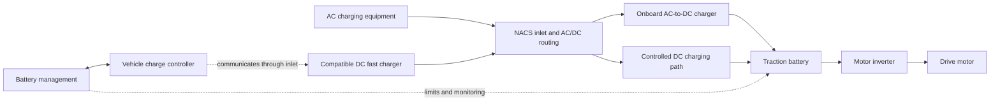

# Bavuso Motors: charging architecture, first decision

October 25, 2026, US Central. Prepared by Codex (GPT-6 family).

## Recommended direction

Continue the roughly 30 kWh baseline with a **400 V-class pack, a native NACS/J3400 inlet, vehicle-side standards-based DC charge control, and a separate onboard AC charger**. Study 6.6 kW AC as the preferred home-charging option, with 3.3 kW as the lighter alternative. Investigate roughly 50 kW DC charging as an initial operating point, subject to cell current, temperature, life and station limits. These power levels are engineering proposals; the owner has not set a charging-time requirement.

The next constraint to resolve is not maximum station power. It is the combination of station access, pack voltage range, cell charge acceptance, cooling while parked and hardware mass.

## Tesla compatibility has two separate requirements

1. **Technical interoperability:** inlet, electrical range, communication, charging controls and successful charging sessions.
2. **Network access:** permission and authorization for the vehicle on the relevant Tesla sites.

Tesla currently distinguishes Tesla-only, All EVs/Magic Dock and manufacturer-access NACS Supercharger sites. Bavuso is not on its public manufacturer-access list. That does not establish that entry is impossible; it means the information reviewed does not establish access for this motorcycle. A physical inlet or a working session on another network is not proof of Tesla access. [Tesla support](https://www.tesla.com/support/charging/supercharging-other-evs)

We should develop standards-based DC charging so the vehicle can also use compatible non-Tesla public equipment. Adapter compatibility, authorization and actual station output still require validation. The Joint Office identifies ISO 15118/DIN SPEC 70121 interoperability as relevant across connector types. [Joint Office connector guidance](https://driveelectric.gov/adapter-compatibility)

Tesla Wall Connectors are AC equipment for homes, workplaces and destinations; Tesla lists output up to 11.5 kW, but the vehicle's onboard charger and the installation determine actual charging power. That is a different capability from Supercharging. [Tesla Wall Connector support](https://www.tesla.com/support/charging/wall-connector)

## Functional architecture

This is a functional diagram, not a wiring schematic. Routing, switching, measurement and interlocks must distinguish AC and DC operation. The DC station performs the large AC-to-DC power conversion off the bike; our 6.6 kW onboard AC charger does not limit the independent DC charging path to 6.6 kW.

Vehicle-side EVCC products handle charging communication and exchange limits with the vehicle/BMS. They do not provide the station's power conversion or establish Tesla access. ADVANTICS publishes DIN 70121 and ISO 15118 support and a CAN integration guide. Continental's EVCC sheet explicitly includes NACS. [ADVANTICS EVCC](https://advantics.fr/products/ADM-CS-EVCC/), [integration guide](https://documentation.advantics.fr/adm-cs-evcc/integration-guide.html), [Continental EVCC sheet](https://conti-engineering.com/wp-content/uploads/2024/10/FS_EVCC_EN.pdf)

## A concrete pack configuration to study

Use **100 series groups, 8 cells per group** as the leading electrical calculation reference for the SA504 cell. It is not a selected physical arrangement or construction instruction. An alternative of 112 series groups with 7 cells per group remains a voltage comparison only.

| Calculated property | Leading reference: 100 × 8 | Voltage comparison: 112 × 7 |
|---|---:|---:|
| Cell count | 800 | 784 |
| Typical nominal energy | 30.06 kWh | 29.45 kWh |
| Energy using published minimum cell Wh | 29.38 kWh | 28.79 kWh |
| Nominal voltage | 340 V | 380.8 V |
| Sum of published cell voltage endpoints | 250–420 V | 280–470.4 V |
| Typical-charge current calculated from cell rating | 86.4 A | 75.6 A |
| Maximum-charge current calculated from cell rating | 172.8 A | 151.2 A |

Inputs: SA504 typical 37.57 Wh, minimum 36.72 Wh, nominal 3.40 V, endpoints 2.50/4.20 V, typical charge 10.8 A, maximum charge 21.6 A. The source's 10.8 A charge current uses a different capacity reference from its typical 11.05 Ah; the table uses the stated amperes, not a rounded C-rate conversion. [Amprius Q3 2026 catalog, PDF page 52](https://amprius.com/documents/Amprius_Product_Catalog.pdf)

Published voltage endpoints are not the proposed everyday operating window, a state-of-charge map or approval to use those endpoints. Cell variation, voltage limits under load, measurement tolerance and reserves must be incorporated. Station voltage support must be verified over the actual charging window; an inlet's maximum voltage rating does not establish a station's minimum output voltage.

Why favor the 100-series reference? It keeps the full-charge endpoint at 420 V and falls within the published 200–430/450 V range of several candidate onboard chargers. A 470.4 V full-charge endpoint would exclude those particular units. The final decision also depends on station interoperability, inverter/motor selection and packaging.

## Charge-time arithmetic, without a fabricated charging curve

For a nominal 30 kWh battery, a 10–80% session represents approximately 21 kWh. Ideal constant **net stored-energy** rates give:

| Average net rate | Energy/time result |
|---|---:|
| 30 kW | 42 minutes |
| 40 kW | 31.5 minutes |
| 50 kW | 25.2 minutes |

These are comparisons, not predicted charging times. Cell limits are expressed as current, voltage changes during charging, charging tapers, and losses/thermal equipment consume power. At the leading reference's 340 V nominal voltage, 50 kW is about 147 A, below the calculated 172.8 A maximum but above the 86.4 A typical charge rating. At 250 V, 50 kW would require 200 A and exceed that maximum. The BMS must reduce current/power when necessary. No flat 50 kW charge curve is assumed.

The published cycle-life result does not validate years of repeated maximum-rate charging. Start evaluation with gentler charging and compare higher rates using data. We should not promise a 20-minute stop from this evidence.

For home charging, 30 kWh / 6.6 kW is 4.55 hours; at 3.3 kW it is 9.09 hours. Those are ideal energy/output-power ratios before taper and auxiliaries, and the charger may be current-limited at lower pack voltage. A 120 V / 12 A source supplies only 1.44 kW before losses: about 20.8 hours by ideal division for 30 kWh. Supporting a household outlet would therefore be useful for partial replenishment, but does not justify promising a full overnight recharge from empty.

## Hardware candidates: narrow the search, do not select from headlines

| Function | Evidence-backed candidate | What it establishes / what remains unknown |
|---|---|---|
| NACS-capable EVCC | Continental Engineering Services EVCC | Published NACS support and approximately 400 g; integration scope, licensing, price and small-volume access unverified |
| Development EVCC comparison | ADVANTICS ADM-CS-EVCC | Public integration documentation and relevant protocols; confirm native NACS routing/control and intended station interoperability |
| Compact AC charger study | BROGEN 6.6 kW PV1776 catalog entry | Published 200–430 V output, 22 A maximum and ≤3 kg; matching exact hardware revision, input range and supplier approval unverified |
| AC charger/DC-DC integrated reference | TC Charger 6.6 kW / 1.5 kW liquid-cooled family | Published 200–450 V option and 8.7 kg; comparatively heavy but useful for a complete-function benchmark |
| Lower-power integrated alternative | TC Charger 3.3 kW / 1.5 kW liquid-cooled family | Published 200–450 V option and 5.8 kg; lower AC power saves about 2.9 kg between those listed families |

Sources: [Continental](https://conti-engineering.com/wp-content/uploads/2024/10/FS_EVCC_EN.pdf), [ADVANTICS](https://advantics.fr/products/ADM-CS-EVCC/), [BROGEN catalog, PDF page 11](https://www.brogenmotors.com/wp-content/uploads/2024/06/Requirement_SheetOBC.pdf), [TC Charger product list](https://www.on-boardcharger.com/products.html).

The cited BROGEN entry lists 176–264 VAC input, so that particular unit does not establish 120 V home-outlet support. Other catalog entries have different voltage and mass figures: they are not interchangeable. Its dimensions, 373 × 224 × 76.5 mm, also need a real packaging check even at the advertised low mass. No manufacturer specifications here have been independently reproduced.

A useful rejection example: the reviewed CATL/CSI eOBC6.6HV-M01 operates at 450–750 V output and weighs 9.1 kg. It is unsuitable as a direct charger for most of our proposed 250–420 V pack window, despite being labeled a 6.6 kW charger. [CSI datasheet](https://coulombsolutions.com/content/product_flyers/CATL_eOBC6.6HV-M01.pdf)

## Consequences for weight and cooling

The previous 410 lb estimate remains a reference with an unverified 7 kg combined allowance for charging hardware, low-voltage equipment and cooling outside the pack. The 8.7 kg integrated charger alone exceeds that allowance. A ≤3 kg charger might fit much better, but still needs DC/DC conversion, controller, inlet, routing and thermal hardware. Choosing the exact parts matters.

For the next packaging study, carry a **10–14 kg sensitivity allowance** for that combined category, replacing the old 7 kg once, not adding it twice. This is a planning allowance, not a measured bill of materials. It raises the 30 kWh reference to roughly **417–426 lb before contingency**. Using the leading configuration's typical cell mass and energy rather than the rounded 390 Wh/kg headline gives a starting estimate around 413 lb with the old allowance, or approximately **420–428 lb** with this sensitivity. These estimates could move either way as other component allowances are replaced.

The existing 80% cell mass fraction already includes pack-internal cooling and enclosure equipment. Put pumps, radiator, fan and other external equipment in the external category once. At DC charging power of 50 kW, an assumed 3–5% heat fraction would mean roughly 1.5–2.5 kW requiring thermal management, before resolving where heat is generated. This is a sizing sensitivity, not a measurement of the selected cells. Cold-plate design and parked airflow now become concrete packaging tasks.

Weight is the first requirement the owner would consider relaxing slightly, but these results do not create a newly accepted weight maximum. They identify the hardware that must justify its mass.

## Questions prepared for later verification

- Tesla: what vehicle/manufacturer onboarding and interoperability path, if any, applies to a new road motorcycle; which sites and authorization method; what relevant station voltage/current limits?
- EVCC supplier: explicit native NACS support, AC/DC routing responsibilities, protocol versions, BMS integration, test equipment/support and commercial access?
- Cell supplier: full charge curves, DC resistance maps, current/temperature limits, life under our proposed charging use, compression/swelling, availability and exact revision?
- Charger supplier: exact part/revision, 120 V support if needed, current/power envelope over the complete pack window, mass, thermal requirements and integration support?

No messages or inquiries have been sent. The next useful artifact is a dimensioned package and mass budget incorporating these charging components, the leading battery configuration and the comfortable rider envelope. That will test whether this architecture fits the motorcycle we intend to build.
