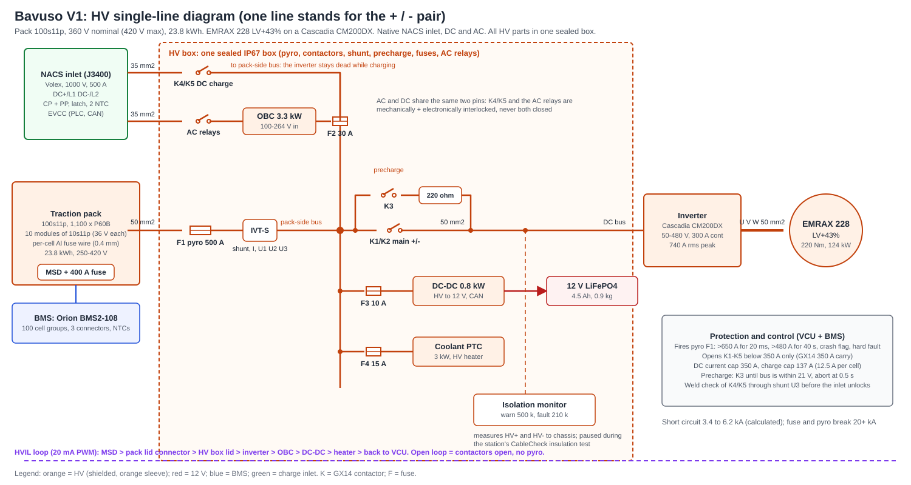
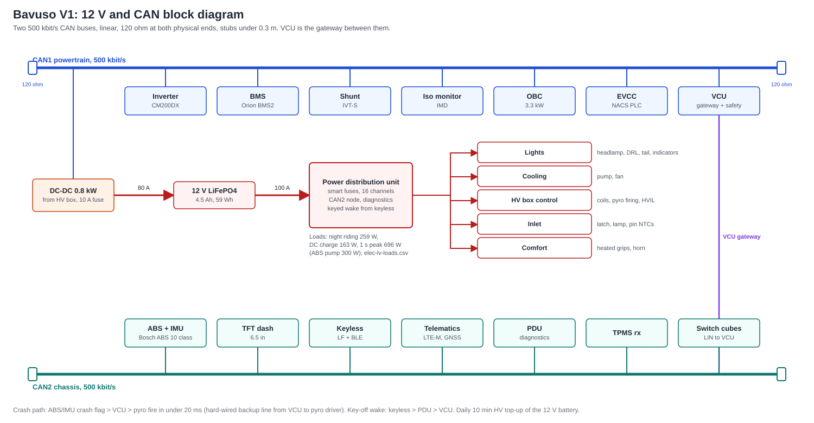
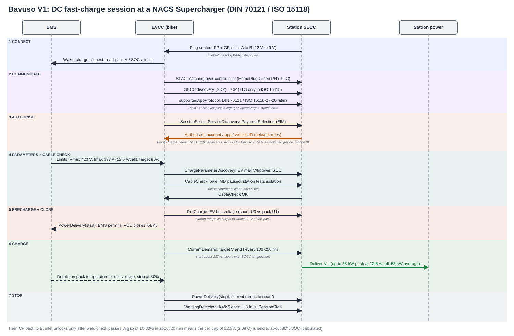

# Bavuso V1 electrical and charging architecture

November 21, 2026, US Central. Prepared by Claude Sonnet 5.5 (claude-sonnet-5-5) for the Bavuso V1 program.

Scripts (run from `v1.0` with the FreeCAD python, in this order): `program/tools/elec-pack.py`, `elec-harness-bom.py`, `elec-diagrams.py`. Data: `program/data/elec-pack.json`, `elec-power-table.csv`, `elec-lv-loads.csv`, `elec-harness.csv`, `elec-bom.csv`, `elec-summary.json`. Diagrams: `program/data/elec-hv-single-line.svg`, `elec-lv-can.svg`, `elec-dc-session.svg`.
Every number is labelled **datasheet / supplier / calculated / estimate**. Inputs for the pack calculations are listed with their basis at the top of `elec-pack.json`.

## The plain answer

**The electrical system closes on paper at 18.4 kg of electronics against an 18 kg budget, about $5.9k of electrical parts at 10k units per year, and a wiring share of 7.6 kg out of the 11 kg wiring-fasteners-fluids budget.** It does one thing the earlier shortlist did not expect: the inverter has to be the Cascadia CM200DX (6.75 kg), not the lighter emDrive H100.

Five findings that change the plan:

1. **The EMRAX 228 needs its "LV+43%" winding on this pack.** The standard MV winding needs 630 V for peak power and the HV winding 830 V; the pack is 250 to 420 V. The LV+43% winding makes full power at 360 V but draws **650 A rms** from the inverter (EMRAX datasheet v1.7).
2. **The emDrive H100 cannot drive that motor.** Its 150 A continuous rating gives about 51 Nm, which is only **29 kW** at 5,500 rpm (target: 55 kW continuous). The CM200DX (300 A continuous, 740 A peak) gives 58 kW continuous and covers the 650 A peak. That costs +3.25 kg against the H100 and puts the **drive group at about 23 kg against its 20 kg budget** (EMRAX 13.2 + CM200DX 6.75 + belt and pulleys 3.1). This is the biggest open item from my side.
3. **The P60B fast-charge risk is retired on paper.** The Molicel datasheet states 30 A maximum charge (5C) and a 6 A standard charge. At 11 cells in parallel, **12.5 A per cell (2.08C, 137 A) gives 10-80% in 20.2 minutes**, at a 58 kW peak and 53 kW average from the station. That is 42% of the cell's stated maximum. Cycle life at 2C is not on the datasheet.
4. **Native NACS works technically. Supercharger access is not established.** The inlet and protocol side is standard (see section 3). Tesla's network authorisation for a new motorcycle maker has no public path that I could find.
5. **The pack is a real heat source.** With the datasheet's 12.8 mohm cell resistance, the 100s11p pack is 125 mohm. It dissipates about 2.4 kW during the 20-minute charge and about 1.8 kW at 125 mph (hand estimate), and 7 to 12 kW in a 30-second 90 kW pull. The cooling agent needs these.

### Verdict table

| # | Item | Result | Required | Status |
|---|---|---|---|---|
| 1 | Pack | 100s11p, 1,100 x P60B, 23.76 kWh gross, 360 V nominal (3.6 V datasheet; Gate A's 370 V uses 3.7 V), 250-420 V | T2 | pass |
| 2 | Pack resistance | 125 mohm (116 cells + 8.5 interconnect, external) | - | calculated |
| 3 | Peak power at the 350 A cap | 96 kW at 10% SOC, 107 kW at 50%, 123 kW at 100% (shaft) | >= 90 kW (T5) | pass, thin at 10% SOC |
| 4 | Cell current at 90 kW, 10% SOC | 29 A per cell (4.9C) | 60 A std, 100 A max | pass |
| 5 | Short-circuit current | 3.4 to 6.2 kA (calculated) | pyro 22 kA, fuse 20+ kA | pass |
| 6 | Per-cell fusing | yes, one 0.4 mm Al wire per cell end; opens 0.19 ms on a shorted cell, neighbours need 19 ms | selective >= 10x | pass (model only) |
| 7 | Precharge | 220 ohm, 715 uF, 95% in 0.47 s, 63 J | <= 0.5 s | pass |
| 8 | DC fast charge 10-80% | 20.2 min at 12.5 A per cell | <= 25 min (T6) | pass |
| 9 | AC charge 10-90% | 6.3 h at 3.3 kW, 3.1 h at 6.6 kW | - | informational |
| 10 | Inverter match | CM200DX passes; H100 fails (29 kW continuous) | 55 kW continuous | **decision made** |
| 11 | Electronics mass | 18.36 kg | 18 kg | **0.36 kg over** |
| 12 | Wiring mass (HV + LV) | 7.56 kg | share of 11 kg | pass, 3.4 kg left for fasteners and fluids |
| 13 | Supercharger access | not established | - | **open** |

## 1. Pack electrical design

### Arrangement

| Level | Content | Voltage | Energy |
|---|---|---|---|
| Cell | Molicel INR-21700-P60B, 6.0 Ah, 21.6 Wh, 75 g max (datasheet) | 2.5-4.2 V | 21.6 Wh |
| Group | 11 cells in parallel | same | 238 Wh, 66 Ah |
| Module | 10 groups in series (10s11p), 110 cells | 36 V nom, 42 V max | 2.38 kWh |
| Pack | 10 modules, 100s11p | 250-420 V (360 nominal) | 23.76 kWh gross |

- **Modules stay under 60 V** (42 V maximum), so they are safe to handle bare during assembly. The module-to-module links are the only bolted high-current joints in the pack.
- **BMS:** Orion BMS2-108 (supplier), 100 cell groups on three connectors (34 / 33 / 33), thermistor expansion module. The manual-service-disconnect link sits at a connector boundary, as in the earlier design and the Orion wiring rule it used. I did not re-verify the Orion rule against the wiring manual for the 100-group case.
- **Busbars:** 0.8 mm aluminium plate per parallel group, 20 g series links, wire-bonded to the cell ends. Interconnects weigh about 4.6 kg (estimate). The earlier study's 24 x 4 mm tapered Al 1350 links were sized for a 433 A peak on a different pack; here the DC current is capped at 350 A, so the same rule (<= 4 A/mm2) is met with about 75 mm2 links (about 2.4 A/mm2 at the 180 A continuous worst case, calculated).

### Fusing

| Layer | Part | Rating | Clears |
|---|---|---|---|
| Cell | Al wire bond, 0.4 mm, one per cell end | opens at about 1.5 kA on a shorted cell | internal cell short |
| Pack | 400 A EV fuse in the service plug at mid-pack | break capacity 20+ kA (class; fuse not chosen) | bolted short |
| Pack | Pyro cut-off, Sensata STP500P class | 500 A, 22 kA break, under 1 ms | medium faults, crash |
| Pack | GX14 contactors | 350 A carry, 12-800 V (datasheet) | normal and BMS open request, below 350 A only |

**Cell-level fuse wires: yes.** A shorted cell is fed by its 10 neighbours (about 1.5 kA through its own bonds). The model gives 0.19 ms to open the shorted cell's wire against 19 ms for a neighbour's wire to melt, a 100x margin; steady heating of the wire at 32 A per cell is 13 K. This is an adiabatic model: it is safe on neighbours surviving and optimistic on opening speed. In practice wire diameter is set by pulse and fusing tests; do not treat 0.4 mm as final. Bonds are placed at both cell ends (2,200 bonds).

**Short-circuit current:** bolted pack fault 3.4 kA (DC impedance) to 6.2 kA (AC impedance), from the datasheet's 12.8 and 6.5 mohm. The 400 A fuse sees 8.4 to 15.5 times its rating, so it clears quickly; the fuse I2t against the cell and busbar withstand was **not checked** because no fuse curve is chosen. The VCU caps DC current at 350 A, which is 0.88 of the fuse rating (below the usual 1.3x no-blow figure) and exactly the GX14 carry rating.

**Pyro trip rules (VCU, from the shunt):** above 650 A for 20 ms; above 480 A for 40 s; crash flag from the ABS/IMU unit within 20 ms; latched BMS hard fault. The contactors open only below 350 A.

### Contactors, precharge, isolation, service disconnect, HVIL

- **Contactors:** five in one HV box. K1 and K2 main (positive and negative), K3 precharge, K4 and K5 DC charge. GX14 at 0.5 kg each (supplier). The DC charge contactors sit on the pack side of the main contactors, so **the inverter and motor stay de-energised while charging**.
- **Precharge:** 220 ohm into 715 uF (650 uF CM200 class from the earlier study plus 65 uF estimated for charger, DC-DC and filters): tau 0.157 s, 95% at 0.47 s, 1.9 A start, 63 J in the resistor. Rule: close K1 when the bus is within 21 V of the pack; abort and latch at 0.5 s (worst-case dissipation into a shorted bus 0.4 kJ; the resistor pulse rating is not confirmed).
- **Active discharge:** the bus must fall below 60 V within 3 s of opening. The inverter's own 70 kohm bleed takes about 88 s (earlier study), so **active discharge must be specified with Cascadia**. Open.
- **Isolation monitor:** Bender iso175 or IR155 class on the HV bus, BMS check as cross-check. ISO 6469-3 asks 100 ohm per volt on the DC side and 500 ohm per volt where the bus is conductively linked to an AC circuit. The onboard charger links them while plugged in, so I set the fault at **210 kohm (500 ohm per volt at 420 V)** in every mode, with a 500 kohm warning. The bike monitor must pause while the station runs its own insulation test.
- **Manual service disconnect:** Amphenol MSD08 class with the 400 A fuse, at a pack connector boundary, with its own interlock contact. Tool-less removal by a trained person only; the sub-60 V modules are then separated from each other.
- **HVIL:** one 20 mA PWM loop through MSD, pack lid connector, HV box lid, inverter, charger, DC-DC and heater, back to the VCU. An open loop opens the contactors; it does **not** fire the pyro (that is reserved for overcurrent and crash).
- **Venting path (note, to the pack agent):** the 21700 can vents from the positive end. Each module needs a gas plenum behind the positive ends with a pressure relief (burst disc or valve) leading to the belly, away from the rider and the inlet. Mica or foam fire barriers between modules. A breather (GORE class) is separate from the burst vent. Thermal-propagation behaviour is **not tested** and is the item UN R136 style testing will probe.

### Motor and inverter match (calculated from the EMRAX 228 datasheet v1.7)

| Winding | Volts for peak power | Peak current | Fits 250-420 V pack? |
|---|---|---|---|
| HV | 830 V | 235 A rms | no |
| MV | 630 V | 360 A rms | no (same finding as `drive-study.md`) |
| **LV+43%** | **360 V** | **650 A rms, 330 A rms continuous** | **yes, chosen** |
| LV+100% | 500 V | 460 A rms | no |
| LV | 250 V | 920 A rms | yes, but needs a larger inverter |

Torque constant for LV+43%: 220 Nm / 650 A = 0.34 Nm/A. Peak power (124 kW at 5,500 rpm) needs 360 V; the pack sits at about 300 to 330 V loaded at low SOC, so **peak power will sag at low charge**. At the 350 A cap the pack still delivers 96 kW shaft at 10% SOC, which meets the 90 kW target. Top speed at 6,500 rpm needs only about 60 Nm (about 175 A) and the no-load speed at 330 V is above 9,000 rpm (from the datasheet Kv; not simulated). **Not simulated:** a motor plus inverter model at 330 V; ask EMRAX and Cascadia to confirm peak and continuous at the actual bus voltage.

## 2. HV and LV schematics

HV single-line: image above (`data/elec-hv-single-line.svg`). 12 V and CAN:

**12 V system.** Loads (estimates, `elec-lv-loads.csv`): night riding **259 W**, DC fast charge **163 W**, 1-second peak **696 W** (ABS pump 300 W). A 0.8 kW isolated DC-DC (0.72 kW usable at 50 degC) is 2.8 times the riding load, so the 12 V battery does not assist at the peak. Battery: 4.5 Ah LiFePO4, 0.9 kg (Shorai class, supplier mass). Limp-home with the DC-DC dead: about 28 minutes on essentials (calculated; earlier study 22 min with heavier loads). Parked standby at 15 mA flattens it in about 9 days, so keep the earlier rule: the VCU wakes once a day and tops it up from the pack for about 10 minutes.

**CAN.** CAN1 powertrain (VCU, inverter, BMS, shunt, isolation monitor, charger, EVCC) and CAN2 chassis (VCU gateway, ABS/IMU, dash, keyless, telematics, distribution unit, TPMS), both 500 kbit/s, linear, 120 ohm at both ends, stubs under 0.3 m, 0.35 mm2 twisted pair. Keyless: LF wake, immobiliser challenge between keyless, VCU and inverter. Start sequence: fob present, stand up, brake held, start; VCU checks BMS, isolation and HVIL; precharge; K1 closes; READY lamp.

## 3. NACS charging

### What was verified, and what was not

| Claim | Evidence | Verified? |
|---|---|---|
| J3400 DC is 500 V or 1,000 V; 1,000 V version is backward compatible | [Wikipedia, SAE J3400](https://en.wikipedia.org/wiki/SAE_J3400) | secondary source |
| J3400 AC up to 80 A at 277 V; typical 48 A at 240 V | same | secondary source |
| NACS uses ISO 15118; CCS1 vehicles can charge at NACS stalls through a pass-through adapter | same; [Joint Office adapter page](https://driveelectric.gov/adapter-compatibility) | yes (two sources) |
| Communication is power-line communication (PLC) over the control pilot, based on DIN SPEC 70121 and ISO 15118; the connector supports Plug and Charge as defined in ISO 15118 | [Electronic Design](https://www.electronicdesign.com/21284134) | one trade article; **I did not read the SAE J3400 text itself, which is paid** |
| Tesla's legacy CAN-over-pilot still exists; Superchargers were retrofitted to speak both CAN and ISO 15118 | Wikipedia (same page) | secondary source |
| DC pins: DC+/L1, DC-/L2 shared with AC; CP and PP signalling; ground | same | secondary source |
| Pre-2021 Teslas need a retrofit for CCS1 | same | not relevant to V1 |

### Technical path for V1

- **DC.** Inlet (Volex J3400, 1,000 V, 500 A, supplier datasheet) to two dedicated contactors (K4, K5), then straight to the pack. No onboard conversion, so the 3.3 kW onboard charger does not limit DC. The EVCC (ADVANTICS class, which publishes DIN 70121 and ISO 15118 support per the earlier charging study) runs SLAC matching, then the DIN 70121 / ISO 15118-2 message set, exchanges limits with the BMS and drives the inlet lock. Sequence: connect, SLAC, application protocol, session setup and authorisation, parameter discovery, cable check, precharge, power delivery, current demand loop, stop, weld detection.
- **Charge limits for the station:** V up to 420 V, I up to 137 A (12.5 A per cell), derated by pack temperature and cell voltage, target 80%.
- **AC.** J3400 AC uses the same two power pins as DC (L1/L2). A pair of AC relays in the HV box routes the pins to the onboard charger, **mechanically and electronically interlocked with K4/K5 so both are never closed**. The earlier design left this routing open; it is now defined. The J1772 control-pilot PWM states (A to F) are used for AC; the EVCC reads them.
- **Charger input.** Specify **100 to 264 V AC input**. The BROGEN class unit in the earlier shortlist lists only 176 to 264 V (earlier charging study), so it would not charge from a 120 V outlet. At 120 V / 12 A (about 1.3 kW delivered) 10-80% takes about 13 hours (calculated).
- **Times** (calculated, 92% charger efficiency): 3.3 kW gives 6.3 h for 10-90% and 7.8 h for 0-100%; 6.6 kW gives 3.1 h and 3.9 h and costs about +3 kg, which does not fit the 18 kg budget. Recommendation: **3.3 kW**.

### DC fast-charge sweep (calculated, `elec-pack.json`)

| Cell cap | C-rate | Pack current | 10-80% | Avg / peak station kW | Avg pack heat |
|---|---|---|---|---|---|
| 8 A | 1.33 | 88 A | 31.5 min | 34 / 37 | 1.0 kW |
| 10 A | 1.67 | 110 A | 25.2 min | 42 / 46 | 1.5 kW |
| **12.5 A** | **2.08** | **137 A** | **20.2 min** | **53 / 58** | **2.4 kW** |
| 16 A | 2.67 | 176 A | 15.8 min | 69 / 74 | 3.9 kW |
| 25 A | 4.17 | 275 A | 10.5 min | 106 / 116 | 8.8 kW |

The model assumes constant current until the cell reaches 4.2 V and a typical NMC open-circuit curve (my estimate, not from the datasheet). 12.5 A per cell is the lowest cap that meets the 20-minute target. The datasheet's charge limit is for 25 degC; cold-weather derate and 2C life are open.

### What Supercharger access needs (be honest with the owner)

Three separate things:

1. **Technical interoperability.** Native J3400 inlet, 250 to 420 V window, a DIN 70121 / ISO 15118 EVCC, and a session that completes. This is within reach.
2. **Network authorisation.** The sources I found describe automaker onboarding: [TechCrunch's tracker](https://techcrunch.com/2025/03/20/tesla-superchargers-gm-ford-rivian-and-other-ev-brands-with-access/) reports that non-Tesla drivers use their own automaker's app, while the Tesla app handles Magic Dock sites; access is granted vehicle model by model. Tesla's own page (`tesla.com/support/charging/supercharging-other-evs`, which the earlier charging study cited) returned 403 to me, so I rely on that study's reading that Bavuso is not on Tesla's public manufacturer list. **No public onboarding path for a new motorcycle maker was found.**
3. **Plug and Charge.** This needs ISO 15118 certificates and a backend PKI ([Electrek](https://electrek.co/2023/07/12/sae-wants-to-certify-nacs-by-end-of-year-and-fix-plug-charge-too/?extended-comments=1) describes it as slow to roll out). It cannot be assumed on any network. V1 should ship with the EVCC able to do external-payment (app or card) sessions first, and certificate support as a software roadmap item.

**Plan:** (a) design to J3400 and DIN 70121 / ISO 15118 and test at non-Tesla DC stations with a cable-side J3400 to CCS1 adapter; (b) request Tesla onboarding as a manufacturer (action for the owner; I sent nothing); (c) do not promise Supercharger access in the spec until Tesla confirms in writing. A physical inlet or a session on another network is not proof of access.

## 4. Harness

Runs are in `elec-harness.csv`. **Lengths are estimates** scaled from the routes measured in the CAD for the previous design, plus or minus 30%, because the V1 layout is not frozen. Cable mass per metre: 50 mm2 shielded 0.63 kg/m (supplier, Coroflex), others estimate.

| Run | Gauge | Length | kg |
|---|---|---|---|
| Pack + to HV box | 50 mm2 | 0.50 m | 0.32 |
| Pack - to HV box | 50 mm2 | 0.40 m | 0.25 |
| HV box to inverter DC +/- | 2 x 50 mm2 | 2 x 0.35 m | 0.44 |
| Motor phases U V W | 3 x 50 mm2 | 3 x 0.40 m | 0.76 |
| Inlet to HV box (DC+/L1, DC-/L2) | 2 x 35 mm2 | 2 x 0.80 m | 0.74 |
| AC relays to charger; charger DC to bus | 4 x 4 mm2 | 4 x 0.50 m | 0.20 |
| DC-DC and heater feeds | 4 x 2.5 mm2 | 4 x 0.50 m | 0.15 |
| Bonding straps | 8 x 6 mm2 | 8 x 0.30 m | 0.14 |
| Connectors (12 PowerLok class, 14 small, 8 lugs) and conduit | - | - | 2.54 |
| **HV total** | | about 8.4 m of cable | **5.53** |
| LV: battery, DC-DC and ABS feeds (10 and 4 mm2) | 10 / 4 mm2 | 3.5 m | 0.27 |
| LV: front trunk, rear trunk, HV-box control, inlet, cooling, keyless, grips (0.5-1.5 mm2) | 0.5-1.5 mm2 | 7 runs | 0.75 |
| LV: CAN1 and CAN2 twisted pairs | 0.35 mm2 | 7 m | 0.11 |
| LV: connectors, seals, loom (80% of wire) | - | - | 0.90 |
| **LV total** | | | **2.03** |
| **Wiring (HV + LV)** | | | **7.56** |

Wiring share: **7.56 kg of the 11 kg wiring-fasteners-fluids budget**. With the ledger's 3.0 kg fastener allowance, that leaves about 0.4 kg for fluids (brake fluid, belt and misc.), which is tight. The HV figure is 1.8 kg higher than the earlier ledger line (3.72 kg) mainly because I count 12 large and 14 small connectors; bolting the inverter DC leads and phases directly (a short-bus layout) would recover about 1 kg. In-pack sense wiring (100 sense wires, 0.97 kg with fuses and thermistors) is in the pack budget, not here.

**Cable sizing (calculated by the earlier study, reused):** 50 mm2 has 212 A ampacity bundled at 65 degC and 301 A in free air. Worst continuous DC current here is 187 A (55 kW at 10% SOC); 125 mph cruise is about 125 A. Phases peak at 650 A rms for seconds and run at about 170 A rms at top speed. 35 mm2 (161 A bundled) carries the 137 A charge and is short. The earlier bend radius finding (3 x OD = 47 mm for 50 mm2) still governs routing.

## 5. Functional safety and standards

I have not run a hazard analysis. The table lists what applies to V1 and what evidence each needs. Items marked "from knowledge" were not re-read from the standard text.

| Standard | Applies to V1? | Why | Evidence needed |
|---|---|---|---|
| **ISO 26262, Part 12 (motorcycles, MSIL A to D)** | Yes, as the development basis. Not a US legal requirement (from knowledge) | Torque control, BMS and contactor control are safety related | Hazard analysis and MSIL ratings; safety goals; functional and technical safety concept; hardware and software safety analysis (FMEDA); verification plan. The Orion BMS2 is not an ISO 26262 certified part, so a production BMS needs an assessed design |
| **ISO 6469-1/-2/-3** | Yes | Pack safety, operational safety, electrical safety | Isolation resistance at 210 kohm or better (500 ohm per volt), IPXXD on HV boxes, equipotential bond under 0.1 ohm, HVIL, marking, post-crash isolation |
| **UN ECE R136** | Reference now; legally needed only for UN-regulation markets (not for US sale; from knowledge) | Safety of L-category electric power train, including REESS tests | Vibration, thermal shock, mechanical, fire, short-circuit, overcharge, over-discharge, over-temperature tests on the pack; isolation tests |
| **UL 2580** (batteries for electric vehicles) | Voluntary; likely the pack standard for a road motorcycle | Pack abuse and safety tests | Pack test report from a lab; BMS safety function evidence |
| **UL 2271** (batteries for light EVs) | Scope probably not a 125 mph motorcycle; **confirm with UL** | I did not read the scope clause | Only if UL confirms scope |
| **UN 38.3** | Yes, to ship cells and the pack | Transport tests T1 to T8 | Cell test summary from Molicel (ask); pack-level test summary, because a 23.8 kWh pack is a large battery |
| **FMVSS 108** | Yes, mandatory in the US | Lamps and reflectors on motorcycles | DOT-marked headlamp, tail, stop, turn signals and plate lamp, reflex reflectors, photometric and aim; the light band must meet the lamp it replaces |
| **FMVSS 122, 123** (from knowledge) | Yes | Motorcycle brakes (ABS optional, regen and ABS must blend), controls and tell-tales | Brake test report; tell-tale and control labelling |
| **SAE J1772 / J3400** | Yes | AC coupler geometry, pilot, DC and AC pinout; J3400/1 adapters | Inlet sourced from a supplier with J3400 / UL 2251 listing (Volex lists both); charge-control conformance tests |
| **ISO 15118-2/-20 and DIN SPEC 70121** | Yes | DC charging communication | EVCC conformance and interoperability tests against several stations |
| **UN R10, FCC Part 15** (from knowledge) | Yes | EMC and radio modules | EMC test report; module grants for keyless and telematics |
| **ISO 16750 / ISO 20653 / IEC 60664-1** | Design basis | Environment, ingress, insulation coordination | Component test reports; creepage and clearance audit (earlier study's values are design intent) |
| **ISO 21434 / UN R155** | Not required for US motorcycles (from knowledge) | Cybersecurity of keyless and telematics | Optional threat analysis; worth doing for keyless |

Preliminary hazard list, for the hazard analysis (my guess at the hazards; the **MSIL values are not assigned**): unintended or excessive drive torque; unintended regen torque locking the rear wheel; loss of propulsion at speed; loss of braking assist or ABS during regen; electric shock (HV exposure, loss of isolation); battery thermal runaway; inlet unlocking while HV is live; loss of lighting. Safety mechanisms already in the design: dual torque-plausibility check in VCU and inverter, contactors weld-checked, HVIL, pyro, isolation monitor, side-stand and brake interlock.

## 6. Mass and cost against the 18 kg electronics budget

Source: `elec-bom.csv`. "E" lines count against the 18 kg electronics budget.

| Group | Items | kg | $ prototype | $ at 10k/yr |
|---|---|---:|---:|---:|
| Charging and HV (E) | OBC 3.3 kW 3.50, HV box + 4 x GX14 + precharge + pyro + shunt + AC relays + fuses + isolation monitor 4.50, inlet + EVCC 1.90 | 9.90 | 4,005 | 1,935 |
| BMS (E) | Orion BMS2-108 + expansion | 1.62 | 950 | 570 |
| DC-DC and 12 V (E) | DC-DC 1.50, 12 V battery 0.90 | 2.40 | 370 | 210 |
| Controllers and display (E) | VCU 0.40, distribution 0.80, dash 0.75, keyless 0.25, telematics 0.15 | 2.35 | 3,350 | 655 |
| Lights, horn, sensors (E) | headlamp 0.90, tail 0.35, indicators 0.24, plate 0.10, horn 0.25, sensors 0.25 | 2.09 | 670 | 244 |
| **Electronics total (E)** | | **18.36** | **9,345** | **3,614** |
| Budget | | 18.00 | | |
| Over budget | | **+0.36** | | |
| Inverter CM200DX (drive budget) | | 6.75 | 2,500 | 1,300 |
| Pack electrical (pack budget) | busbars 4.55, sense harness 0.97, MSD + fuse 0.40 | 5.92 | 2,030 | 460 |
| Wiring (wiring budget) | HV 5.53 + LV 2.03 | 7.56 | 1,600 | 500 |
| **All electrical except cells, motor, charger-in-E** | | 38.6 | | **about 5,900** |

Notes:
- **Over budget by 0.36 kg (2%), with no margin.** Almost every mass here is a class estimate (OBC, DC-DC, VCU, dash, lights). Levers if needed: drop the thermistor expansion module (0.15 kg) by using fewer NTCs; use a shorter bus layout (about 1 kg of wiring, but that is wiring budget); a lighter lamp unit.
- The earlier shortlist's "HV box 2.7 kg" covered only contactors, box and precharge. With the pyro (0.40), shunt (0.20), AC relays (0.30), fuses (0.15) and isolation monitor (0.15) added, the real figure is 4.50 kg. For the same functions without cables, the earlier shortlist had 11.4 kg and this design has 13.0 kg.
- **Cost:** $5.9k per bike for all electrical parts except cells, motor and the 12 V items already counted, at 10k per year (estimates from retail listings and the earlier BOM, not quotes). Prototype cost is about 2.8 times higher. The EMRAX 228 and the 1,100 P60B cells are outside this table.

## CAD change requests (brief)

The layout is not frozen, so these are placement rules with sizes. I did not touch `build-adventure.py`.
1. **One HV box**, about 280 x 160 x 110 mm (estimate from four GX14 plus pyro, shunt, relays; confirm from drawings), within 0.5 m of the pack terminals and within 0.4 m of the inverter. It must hold K1 to K5, the pyro, the shunt and the AC relays, with a tool-only lid and a drain.
2. **Inlet** (84 x 68 x 95 mm, plus hinged door and drain) within 0.8 m of the HV box. Door opening about 90 x 75 mm.
3. **Onboard charger** with a cold plate (BROGEN class is 373 x 224 x 76.5 mm; the real 3.3 kW part is not chosen), within 0.5 m of the HV box and the inlet.
4. **Motor phase terminals** on the EMRAX 228 top-right, facing up and forward (as in the earlier request); phases under 0.4 m.
5. **Pack interface:** two power studs and a service-disconnect access point on the same face as the HV box; a vent path from each module's positive end to the belly; 10 module boundaries.
6. **12 V battery** (0.9 kg) and the distribution unit under the seat front, as before.
7. **Mass ledger:** electronics 18.36 kg; inverter 6.75 kg is already in drive; the drive group is about 23 kg against 20 kg. Delete the DC-DC line double count (already flagged).

## What this does not prove

- **No supplier was contacted and no quote exists.** Masses and prices for the charger, DC-DC, VCU, dash, lights, keyless, telematics, pyro, shunt and relays are class estimates. GX14, the Molicel cell and the EMRAX motor values are from datasheets (EMRAX and GX14 local copies, Molicel fetched).
- **The OCV curve, the charge-time model and all thermal numbers are estimates.** The 20-minute charge is a model result at 25 degC; cold charge, cell ageing and 2C cycle life are not known. The P60B datasheet does not give cycle life at 2C.
- **The cell fuse wire model is adiabatic** and unproven by test. Fuse I2t coordination was not checked because no fuse is chosen.
- **Motor and inverter behaviour at the real bus voltage was not simulated.** Peak power at low charge will sag below the 124 kW datasheet figure.
- **Harness lengths are scaled estimates** and the V1 layout can change them by plus or minus 30%. Nothing was checked in CAD (clearance, bend radius, routing).
- **Standards were not read.** J3400, ISO 15118, DIN 70121, ISO 26262, ISO 6469, R136 and the UL standards are described from secondary sources or knowledge. No hazard analysis, MSIL rating or FMEA was done.
- **Supercharger access and Plug and Charge are not established** and no inquiry was sent. Tesla's own support page could not be fetched.
- The 400 A fuse, the iso175 class monitor and the STP500P class pyro are not selected parts.
- The Orion BMS2 connector-boundary rule for the 100-group case and its fitness as a production BMS were not verified.
- Diagrams were checked by eye at their native size for overlap, not against a formal drawing standard.
